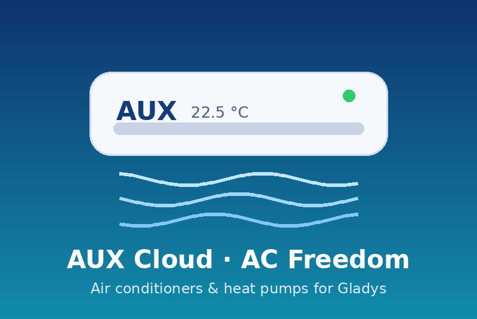

# AUX Cloud (AC Freedom) for Gladys Assistant

External integration for [Gladys Assistant](https://gladysassistant.com) that
controls **AUX air conditioners and heat pumps** through the AUX cloud used by
the **AC Freedom** mobile app.



- Air conditioners: power, mode, target temperature, fan speed, swing, room
  temperature, eco / sleep / display / health / auxiliary heat / self clean /
  child lock / mildew proof / comfortable wind switches.
- Heat pumps: heating, hot water, setpoints, tank temperature, fast hot water,
  quiet and eco modes.
- Scene triggers (on/off, error, online/offline), scene actions (set an air
  conditioner, set hot water, turn everything off) and two dashboard widgets.
- Cloud only (`transports: ["cloud"]`), Gladys **5.1.0** or later.
- English, French, German and Spanish.

User documentation: [English](docs/en.md) · [Français](docs/fr.md) ·
[Deutsch](docs/de.md) · [Español](docs/es.md).

## How it works

AUX publishes no official API. The integration speaks the protocol of the AC
Freedom app (BroadLink DNA cloud), ported to Node.js from the Home Assistant
integration [ha-aux-cloud](https://github.com/maeek/ha-aux-cloud) — see
[`THIRD_PARTY_NOTICES.md`](THIRD_PARTY_NOTICES.md):

1. log in with the AC Freedom account (encrypted login request, as the app);
2. list the families of the account and their personal and shared units;
3. every `poll_frequency` seconds, query the online state of all units in one
   batch, then read the parameters of the online ones;
4. publish the changed states to Gladys, fire the scene triggers on the edges,
   nudge the dashboard widgets;
5. write a command as a single `KeyValueControl` request, and reflect it in
   Gladys at once.

## Project structure

```
.
├─ index.js                  # SDK bootstrap + event wiring
├─ src/
│  ├─ aux/                   # AUX cloud client, errors, product profiles
│  ├─ devices/               # Gladys features <-> AUX parameters
│  ├─ runtime.js             # inventory + refresh loop
│  ├─ triggers.js            # scene triggers
│  ├─ scenes.js              # scene actions
│  ├─ widgets.js             # dashboard widgets
│  ├─ actions.js             # Configuration screen buttons
│  └─ config.js              # config defaults + normalization
├─ docs/                     # user documentation (en, fr, de, es)
├─ test/                     # node --test, fake Gladys + fake AUX cloud
├─ gladys-assistant-integration.json
├─ Dockerfile
├─ CHANGELOG.md · SECURITY.md · CLAUDE.md
```

## Development

```bash
npm install
npm test
npm run lint
npm run format:check
```

Tests never reach the network: `test/helpers/fakeAuxCloud.js` answers the
endpoints the client uses, and the SDK's fake Gladys checks every payload the
way the core does. The project rules are in [`CLAUDE.md`](CLAUDE.md).

Run it against a Gladys instance by installing it from the integration store,
or locally with the variables the supervisor provides:

```bash
GLADYS_HOST_API_URL=http://localhost:1443 \
GLADYS_INTEGRATION_TOKEN=<token> \
GLADYS_INTEGRATION_SELECTOR=<selector> \
node index.js
```

## Release

1. Describe the changes under `## [Unreleased]` in
   [`CHANGELOG.md`](CHANGELOG.md).
2. **Actions → Release → Run workflow**, pick `patch`, `minor` or `major`.

The workflow bumps the version in `package.json` and in the manifest
(`version` and `docker_image`), moves the changelog section, tags `vX.Y.Z`,
builds the multi-arch image to `ghcr.io/gboulvin/gladys-aux-cloud` and
publishes the GitHub Release. The repository carries the
`gladys-assistant-integration` topic so the store indexer picks it up.

## Security

See [`SECURITY.md`](SECURITY.md) to report a vulnerability, and how the
integration handles the account credentials.

## License

Apache-2.0. The AUX protocol implementation is derived from ha-aux-cloud
(MIT), see [`THIRD_PARTY_NOTICES.md`](THIRD_PARTY_NOTICES.md). AUX and AC
Freedom are trademarks of their respective owners; this project is not
affiliated with them.
